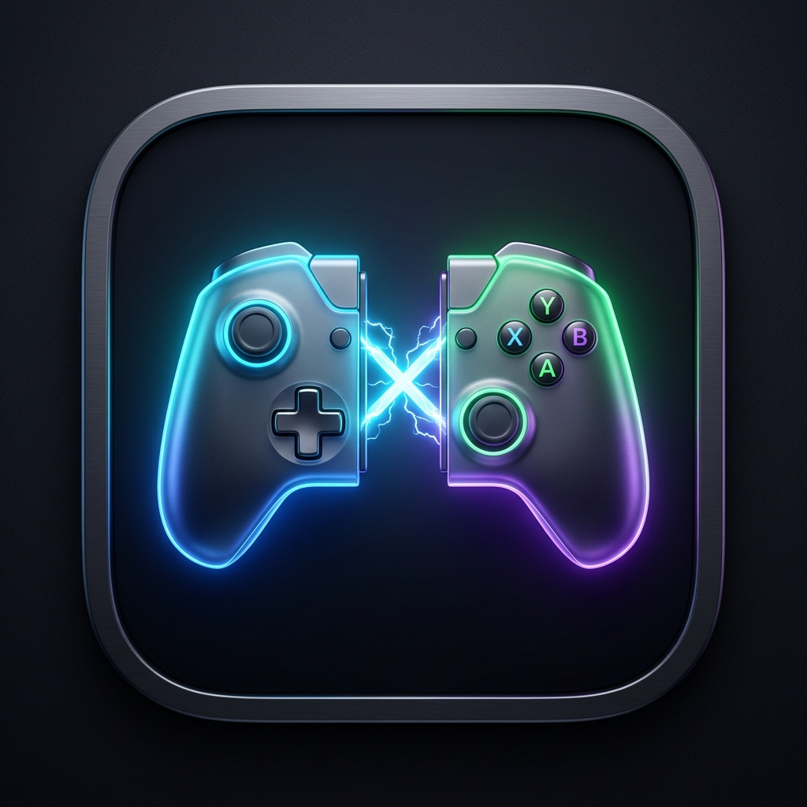

<p align="center">
  
</p>

# 🎮 CrossCoop — Universal Split-Screen Bridge
**True Two-Way Split-Screen Ecosystem: [Nucleus Co-op (Windows)](https://github.com/SplitScreen-Me/splitscreenme-nucleus) ⟷ [PartyDeck (Linux/SteamOS)](https://github.com/partydeck/partydeck)**

[](https://github.com/korgangames/CrossCoop/releases)
[](https://nobaraproject.org)
[](https://python.org)
[](https://www.riverbankcomputing.com/software/pyqt/)

---

## 📖 What is CrossCoop?

PC gaming has two community-driven tools for playing non-split-screen games locally with friends on a single PC:
1. **[Nucleus Co-op](https://github.com/SplitScreen-Me/splitscreenme-nucleus)**: The mature Windows giant boasting over **896 community handlers** refined over 8+ years.
2. **[PartyDeck](https://github.com/partydeck/partydeck)**: The native Linux/SteamOS launcher using **Gamescope** for window composition and **Bubblewrap (`bwrap`)** for hardware controller isolation without input bleed.

Historically, they have been locked in their own separate worlds:
* **The Reality:** Native PartyDeck repositories document only about **10 verified handlers**, while Nucleus Co-op cannot run on Linux because its Win32 API DLL injections and window hooks fail under Wine/Proton.
* **The Solution:** **CrossCoop** provides **built-in browsers for both platforms with complete two-way downloading symmetry**. You can download & install directly to Nucleus Co-op OR convert & install directly to PartyDeck from any screen with 1 click!

---

## 🔗 Official Program Links

| Program | Platform | Core Technology | Official Link |
| :--- | :---: | :--- | :--- |
| **Nucleus Co-op** | Windows | Win32 API, ProtoInput, EasyHook, XInputPlus (896 Games) | [GitHub: SplitScreen-Me/splitscreenme-nucleus](https://github.com/SplitScreen-Me/splitscreenme-nucleus) |
| **PartyDeck** | Linux / SteamOS | Gamescope, Bubblewrap (`bwrap`), UMU, Proton-GE (~10 Games) | [GitHub: partydeck/partydeck](https://github.com/partydeck/partydeck) |

---

## 🌟 True Two-Way Actions (Both Directions Supported)

Every single screen in CrossCoop provides direct installation and export options for **both programs**:

| Location | Action to Nucleus Co-op | Action to PartyDeck | Export Options |
| :--- | :--- | :--- | :--- |
| **SplitScreen.Me Hub (896 Games)** | **🪟 Download to Nucleus Co-op:** 1-Click download official package (.zip) & extract `.js` into `nucleus_coop/handlers/` | **🐧 Convert & Install to PartyDeck:** 1-Click translation into native PartyDeck JSON manifest in `partydeck/handlers/` | `💾 Export Nucleus (.js / .zip)`<br>`📦 Export PartyDeck (.pd2 / .json)` |
| **PartyDeck Community Browser** | **🪟 Convert & Install to Nucleus:** 1-Click conversion of community JSON into Nucleus `handler.js` | **🐧 Install to PartyDeck:** 1-Click installation of community configs directly into PartyDeck | `💾 Export Nucleus (.js)`<br>`📦 Export PartyDeck (.json)` |
| **PartyDeck Installed Tab** | **🪟 Install directly to Nucleus:** 1-Click push of installed games into Nucleus library | (Already installed in PartyDeck) | `💾 Export to File (.js / .zip)` |
| **Nucleus Installed Tab** | (Already installed in Nucleus) | **🐧 Convert & Install to PartyDeck:** 1-Click conversion into PartyDeck | `📥 Import Local Handlers`<br>`💾 Save Changes` |
| **Two-Way Converter** | **🪟 Install to Nucleus Co-op:** 1-Click direct install to Nucleus handlers | **🐧 Install to PartyDeck:** 1-Click direct install to PartyDeck handlers | `💾 Save Result to File` |

---

## 🌟 Key Features

### 1. 🌐 Dual In-App Browsers (896+ Games Unlocked)
* **SplitScreen.Me Hub Browser (896+ Games):** Complete live catalog of 896 verified PC games with interactive table header sorting (Title, Downloads, Players, Status), genre filtering, and two-way 1-click install.
* **PartyDeck Community Browser:** Live sync with the official `partydeck/partydeck` GitHub repository to fetch verified and community-submitted issue configs.

### 2. 📥 Import Unofficial & Downloaded Handlers (Lenient Detection)
Downloaded a loose handler script or experimental package from Discord, Reddit, or SplitScreen.Me forums?
* Click the **"📥 Import Local / Downloaded Handler"** button.
* CrossCoop’s resilient, lenient parser auto-detects game executables, Steam AppIDs, Goldberg LAN emulators, and custom launch arguments even from unconfirmed or non-standard `.js`, `.zip`, `.nc`, `.json`, and raw text scripts.

### 3. 🛡️ Intensive 8-Phase Pre-Flight Stability Audit
Before launching any game, CrossCoop verifies your system to prevent crashes, input bleed, and port collisions:
1. **Executable & Steam Library Check:** Verifies binary presence, execute permissions, and architecture.
2. **Controller Enumeration & Masking:** Probes `/dev/input/` to ensure sufficient gamepads for the requested player count.
3. **Bubblewrap Sandbox Permissions:** Confirms unprivileged `bwrap` namespace support.
4. **Gamescope Geometry & Tiling:** Computes exact quadrant resolutions and windowed mode flags (`-windowed`, `-popupwindow`).
5. **Steam AppID & Goldberg LAN Emulation:** Checks socket configuration and local networking.
6. **Network Port Collision Test:** Scans ports (Goldberg `47584`, game ports `27015`, `7777`) for orphaned background processes.
7. **Proton / UMU Compatibility:** Verifies runner availability and prefix isolation.

### 4. 🚀 Dual Launcher & Custom Bootables
* Launch either **PartyDeck** or **Nucleus Co-op** with one click directly from CrossCoop’s header bar.
* Configure custom bootable paths (AppImages, custom binaries, or runner scripts) in the **Settings** tab.

---

## 📥 Releases & Download

### Option 1: Standalone Script (Recommended)
You can clone and run CrossCoop directly on Nobara Linux, Fedora, SteamOS, or Ubuntu:

```bash
# Clone the repository
git clone https://github.com/korgangames/CrossCoop.git
cd CrossCoop

# Launch CrossCoop GUI
./crosscoop.sh
```

### Option 2: Pre-Packaged Releases
Download prebuilt archives and tagged releases from the [GitHub Releases Page](https://github.com/korgangames/CrossCoop/releases).

---

## 🚀 Quick Start Guide (Nobara Linux & SteamOS)

1. **Launch CrossCoop:**
   ```bash
   ./crosscoop.sh
   ```
2. **Browse or Import a Game:**
   * Open the **🪟 Nucleus Co-op** tab to search 896+ games, or **🐧 PartyDeck** to search community submissions.
   * Click **"🪟 Download to Nucleus Co-op"** to install for Nucleus, or **"🐧 Convert & Install to PartyDeck"** to install for PartyDeck.
3. **Run Pre-Flight Audit:**
   * Switch to the **🛡️ Pre-Flight Stability Audit** tab.
   * Select the game and click **"Run Intensive Stability Audit"** to ensure zero port collisions and verified controller isolation.
4. **Play:**
   * Click **"🚀 Run PartyDeck"** or **"🪟 Run Nucleus Co-op"** in the top bar to start gaming!

---

## 🛠️ Requirements
* **Operating System:** Nobara Linux, SteamOS, Fedora, Arch, or Ubuntu.
* **Compositor:** Wayland or X11 (Gamescope supported).
* **Dependencies:** Python 3.10+, PyQt6 (`pip install PyQt6`).
